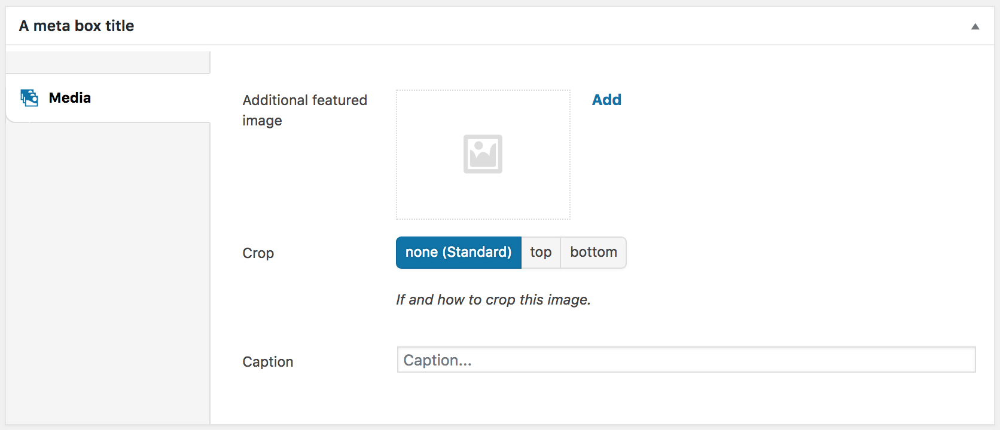

# MP Custom Fields

A WordPress plugin for registering custom fields from code, with a clean, tabbed interface in the WordPress admin.

MP Custom Fields is meant as a lean alternative to large custom field plugins: fields are defined in PHP (in your theme or plugin), stored as regular post, term, user or option meta, and read with the usual WordPress functions.



---

## Contents

1. [Installation](#installation)
2. [Quick start](#quick-start)
3. [Concepts: boxes, panels and fields](#concepts-boxes-panels-and-fields)
4. [Where fields can be added](#where-fields-can-be-added)
5. [Field settings shared by all types](#field-settings-shared-by-all-types)
6. [Field types](#field-types)
7. [Nested fields: repeaters, conditional fields and panels](#nested-fields-repeaters-conditional-fields-and-panels)
8. [Showing fields depending on other fields](#showing-fields-depending-on-other-fields)
9. [Reading values](#reading-values)
10. [Field actions (callbacks)](#field-actions-callbacks)
11. [Writing your own field type](#writing-your-own-field-type)
12. [Plugin settings](#plugin-settings)
13. [Filters](#filters)
14. [Saving](#saving)
15. [Security](#security)
16. [Error reporting](#error-reporting)
17. [Good to know](#good-to-know)
18. [Development](#development)

For LLMs and coding agents, [AGENTS.md](AGENTS.md) summarises the API and the rules for changing the plugin.

---

## Installation

1. Copy the plugin folder to `wp-content/plugins/mp-custom-fields/`.
2. Activate **MP Custom Fields** under *Plugins* in the WordPress admin.
3. Register your fields in your theme's `functions.php` or in your own plugin (see below).

Requirements: a current WordPress version and PHP 7.4 or newer.

---

## Quick start

```php
add_action('init', 'mytheme_register_custom_fields', 20);

function mytheme_register_custom_fields() {
	if (!function_exists('mpcf_add_custom_fields')) return;    // plugin not active

	$mediaPanel = array(
		'name'   => 'Media',
		'icon'   => 'dashicons-images-alt',
		'fields' => array(
			array(
				'name'  => 'thumbnail2',
				'title' => 'Additional featured image',
				'type'  => 'media'
			),
			array(
				'name'        => 'thumbcrop',
				'title'       => 'Crop',
				'type'        => 'buttongroup',
				'options'     => array(
					'none'   => 'none',
					'top'    => 'top',
					'bottom' => 'bottom'
				),
				'default'     => 'none',
				'description' => 'If and how to crop this image.'
			),
			array(
				'name'        => 'thumbcaption',
				'title'       => 'Caption',
				'type'        => 'text',
				'placeholder' => 'Caption...'
			)
		)
	);

	mpcf_add_custom_fields('post', 'metabox-posts', array(
		'title'    => 'Post options',
		'context'  => 'normal',
		'priority' => 'high',
		'panels'   => array($mediaPanel)
	));
}
```

This adds a meta box with one panel ("Media") and three fields to the edit screen of posts. The values are saved under the field names (`thumbnail2`, `thumbcrop`, `thumbcaption`) and read with `mpcf_get_field()`:

```php
$caption = mpcf_get_field('thumbcaption');    // of the current post
```

Register your fields on `init` (as above), after your post types and taxonomies are registered.

---

## Concepts: boxes, panels and fields

- A **box** is a group of fields shown in one place: a meta box on the post edit screen, a section on a term or user profile page, an archive or options page.
- A box contains one or more **panels**. Each panel is a tab in the box's menu, with a `name`, an optional `icon` and its `fields`.
- A **field** has at least a `name` (the key the value is stored under) and a `type`.

```php
$panel = array(
	'name'   => 'General',                // tab title
	'icon'   => 'dashicons-admin-generic', // Dashicons class or the URL of an image (optional)
	'fields' => array( /* fields */ )
);
```

Panels can also be shown depending on field values with `show_if`, see [Showing fields depending on other fields](#showing-fields-depending-on-other-fields).

Box definitions are stored in the WordPress options table and only rewritten when they change, so registering on every request is cheap.

---

## Where fields can be added

| Location | Function | Values are stored as |
|---|---|---|
| Posts, pages, custom post types | `mpcf_add_custom_fields($postType, $id, $args)` | post meta |
| Posts: list of modules | `mpcf_add_module_metabox($postType, $id, $args)` | post meta (one array) |
| Terms (categories, tags, custom taxonomies) | `mpcf_add_custom_fields_taxonomy($taxonomy, $id, $args)` | term meta |
| User profiles | `mpcf_add_custom_fields_user($roles, $id, $args)` | user meta |
| Post type archives | `mpcf_add_custom_fields_archive($postType, $id, $args)` | option `mpcf_archive_meta` |
| Options pages ("singletons") | `mpcf_register_singleton($id, $args)` + `mpcf_add_custom_fields_singleton($singletonID, $id, $args)` | option `mpcf_{id}` |

`$id` is a unique identifier for the box. Boxes stay registered until they are removed again with `mpcf_remove_custom_fields($id)`, `mpcf_remove_module_metabox($id)`, `mpcf_remove_custom_fields_taxonomy($id)`, `mpcf_remove_custom_fields_user($id)`, `mpcf_remove_custom_fields_archive($postType)`, `mpcf_remove_custom_fields_singleton($id)` or `mpcf_remove_singleton($singletonID)`. Removing a box keeps the saved values, except for archives: `mpcf_remove_custom_fields_archive()` also deletes the archive's values.

### Posts, pages and custom post types

```php
mpcf_add_custom_fields('page', 'page-options', array(
	'title'         => 'Page options',  // default: "{Post type} Options"
	'context'       => 'normal',        // normal, side or advanced
	'priority'      => 'default',       // high, core, default or low
	'post_format'   => '',              // only for posts, see below
	'page_template' => '',              // only for pages, see below
	'panels'        => array( /* panels */ )
));
```

Limit a box to certain post formats or page templates with a comma-separated list or an array. A leading `-` excludes, `frontpage` and `postspage` stand for the pages set under *Settings → Reading*:

```php
'page_template' => 'templates/landing.php, frontpage'
'post_format'   => '-aside, -status'
```

### Module boxes

A module box lets editors build content from a list of modules of different types, which can be added, moved, collapsed and removed:

```php
mpcf_add_module_metabox('page', 'page-modules', array(
	'title'     => 'Content modules',
	'base_name' => 'modules',            // the post meta key, default: "modules"
	'modules'   => array(
		'text' => array(
			'title'  => 'Text',
			'icon'   => 'dashicons-editor-paragraph',
			'fields' => array(
				array('name' => 'headline', 'title' => 'Headline', 'type' => 'text'),
				array('name' => 'content',  'title' => 'Text',     'type' => 'editor')
			)
		),
		'gallery' => array(
			'title'  => 'Gallery',
			'icon'   => 'dashicons-format-gallery',
			'fields' => array(
				array('name' => 'images', 'title' => 'Images', 'type' => 'bulkmedia')
			)
		)
	)
));
```

All modules are stored together in one post meta value: an array of modules, each with its field values and its type in `module_type`.

### Terms

```php
mpcf_add_custom_fields_taxonomy('category', 'category-options', array(
	'title'    => 'Category options',
	'priority' => 0,                     // order of several boxes on the same taxonomy
	'panels'   => array( /* panels */ )
));
```

### User profiles

```php
mpcf_add_custom_fields_user(array('administrator', 'editor'), 'user-options', array(
	'title'  => 'Social media',          // default: "User options"
	'panels' => array( /* panels */ )
));
```

`$roles` is a role, an array of roles or `'all'`.

### Post type archives

Adds an *Archive* page below the post type's menu, e.g. for an archive's intro text:

```php
mpcf_add_custom_fields_archive('project', 'project-archive', array(
	'title'      => 'Project archive',
	'capability' => 'edit_posts',        // who may edit the archive fields
	'panels'     => array( /* panels */ )
));
```

### Options pages

```php
mpcf_register_singleton('site-options', array(
	'title'      => 'Site options',
	'icon'       => 'dashicons-admin-settings',
	'capability' => 'edit_pages',
	'parent'     => null,                // a menu slug to add it as a sub page instead
	'position'   => null                 // position in the admin menu
));

mpcf_add_custom_fields_singleton('site-options', 'site-options-contact', array(
	'title'  => 'Contact',
	'panels' => array( /* panels */ )
));
```

The values are stored in one option, by default named `mpcf_{id}` (`mpcf_site-options` above; change it with the `optionName` argument).

---

## Field settings shared by all types

| Setting | Description |
|---|---|
| `name` | **Required.** The key the value is stored under. Unique within its box. |
| `type` | **Required.** One of the [field types](#field-types). |
| `title` | Label shown above the field. |
| `description` | Help text shown below the field. |
| `default` | Value used as long as nothing has been saved. |
| `required` | `true` to make the field mandatory (for most types). |
| `inputClass` | Additional CSS class(es) for the input element. |
| `actions` | Callbacks, see [Field actions](#field-actions-callbacks). |
| `show_if` | Show the field only if other fields have certain values, see [Showing fields depending on other fields](#showing-fields-depending-on-other-fields). |

All other settings depend on the field type.

---

## Field types

### Text

| Type | Description | Settings |
|---|---|---|
| `text` | Single-line text | `placeholder`, `minlength`, `maxlength`, `list` (suggestions, comma-separated) |
| `textarea` | Multi-line text | `placeholder`, `rows`, `addparagraphs` |
| `editor` | WordPress editor (TinyMCE), initialised once it becomes visible (see [Good to know](#good-to-know)) | `height`, `rows`, `mediabuttons`, `minimaleditor`, `dragdrop`, `addparagraphs`, `css` |
| `email` | Email address | `placeholder`, `minlength`, `maxlength`, `multiple`, `autocomplete` |
| `password` | Password | `minlength`, `maxlength` |

### Numbers

| Type | Description | Settings |
|---|---|---|
| `number` | Number | `placeholder`, `min`, `max`, `step` (default `any`) |
| `range` | Slider | `min`, `max`, `step` |

### Date and time

| Type | Description | Settings |
|---|---|---|
| `date` | Date | `placeholder`, `min`, `max` |
| `datetime` | Date and time | `placeholder`, `min`, `max` |
| `month` | Month | `placeholder`, `min`, `max`, `step` |
| `week` | Week | `placeholder`, `min`, `max`, `step` |
| `time` | Time | `placeholder`, `min`, `max`, `step` |

### Choices

Choices are given as `value => label` pairs in `options`:

```php
array(
	'name'    => 'layout',
	'title'   => 'Layout',
	'type'    => 'select',
	'options' => array(
		'wide'   => 'Wide',
		'narrow' => 'Narrow'
	)
)
```

| Type | Description | Settings |
|---|---|---|
| `select` | Dropdown list | `options`, `multiple`, `size` |
| `radio` | Radio buttons | `options` |
| `buttongroup` | Row of buttons, one (or several) can be active | `options`, `multiple` |
| `imagebuttongroup` | Buttons showing an image or icon | `options` (`value => image`, the image being a URL or a Dashicons class) |
| `checkbox` | Single checkbox | `label` |
| `truefalse` | On/off switch | `default` |
| `dragdroplist` | Choose and order entries by drag and drop | `options`, `multiple` |
| `postselect` | Choose a post | `query` (arguments for `get_posts()` or the name of a function returning them), `filter` (name of a function to filter the list) |
| `colorselect` | Choose from a list of colors | `options` (`value => array('title' => …, 'colorcode' => '#ff0000', 'class' => …)`) |

The options of a field can be built dynamically, e.g. from a list of posts. To make sure such lists are always up to date, use `postselect` with a `query` function: it is called each time the field is displayed.

### Media and files

| Type | Description | Settings |
|---|---|---|
| `media` | An image or video from the media library | |
| `bulkmedia` | Several images or videos, with upload by drag and drop | `extensions` (allowed file extensions, comma-separated) |
| `file` | A file from the media library | |

These fields store attachment IDs.

### Layout and other

| Type | Description | Settings |
|---|---|---|
| `color` | Color picker | |
| `grid` | Select an area on a grid | `columns`, `rows` |
| `table` | Table of text fields | `rows`, `columns`, `headings`, `editrows` |
| `map` | Places on a Google map (requires an API key, see [settings](#plugin-settings)) | `center`, `zoom`, `height` |
| `hidden` | Hidden field | |
| `divider` | A visual separator, stores nothing | |
| `custom` | Your own output | `callback` (function called with the field object and its settings) |
| `repeater` | Repeatable group of fields | see below |
| `conditional` | Shows different fields depending on a choice | see below |
| `conditionalpanels` | Shows a different panel depending on a choice | see below |

---

## Nested fields: repeaters, conditional fields and panels

### Repeater

A list of rows with the same fields. Editors can add, move and remove rows: rows are moved with the arrow buttons, by dragging the move handle (mouse or touch), or with the keyboard - focus the move handle with the Tab key and use the arrow keys up and down. Enter or Space activates the other row controls.

```php
array(
	'name'    => 'team',
	'title'   => 'Team members',
	'type'    => 'repeater',
	'maxrows' => 0,                      // 0 = unlimited
	'fields'  => array(
		array('name' => 'person',   'title' => 'Name',     'type' => 'text'),
		array('name' => 'portrait', 'title' => 'Portrait', 'type' => 'media')
	)
)
```

### Conditional field

A dropdown (or a checkbox if there is only one option) that decides which fields are shown below it.

```php
array(
	'name'    => 'background',
	'title'   => 'Background',
	'type'    => 'conditional',
	'options' => array(
		'color' => array(
			'title'  => 'Color',
			'fields' => array(
				array('name' => 'color', 'title' => 'Color', 'type' => 'color')
			)
		),
		'image' => array(
			'title'  => 'Image',
			'fields' => array(
				array('name' => 'image', 'title' => 'Image', 'type' => 'media')
			)
		)
	)
)
```

### Conditional panels field

Like a conditional field, but the fields of the chosen option are shown in an additional panel (tab) of the box. Inside a repeater, this lets editors build a page from a list of content sections:

```php
array(
	'name'    => 'module',
	'title'   => 'Module type',
	'type'    => 'conditionalpanels',
	'options' => array(
		'hero' => array(
			'title' => 'Hero',
			'panel' => array(
				'name'   => 'Hero',
				'icon'   => 'dashicons-format-image',
				'fields' => array( /* fields */ )
			)
		)
	)
)
```

Nested fields can be combined freely: conditional fields inside repeaters, repeaters inside conditional panels, and so on.

---

## Showing fields depending on other fields

With the setting `show_if`, a field (or a whole panel) is only shown if other fields have certain values:

```php
array(
	'name'    => 'linktarget',
	'title'   => 'Open link in',
	'type'    => 'select',
	'options' => array('_self' => 'Same tab', '_blank' => 'New tab'),
	'show_if' => array('field' => 'linkurl', 'operator' => 'not_empty')
),
```

The fields are shown and hidden in the browser as soon as the other field changes, without reloading anything.

**Hidden fields keep their values.** They are only hidden: their values are still sent and saved, so nothing is lost when an editor switches back and forth. When reading values, check the condition yourself if a hidden value should be ignored:

```php
$target = mpcf_get_field('linkurl') ? mpcf_get_field('linktarget') : '_self';
```

This differs from [conditional fields](#conditional-field), which load different sub-fields for each choice.

### One condition

| Key | Description |
|---|---|
| `field` | The `name` of the other field (see [Which field is meant](#which-field-is-meant)). |
| `operator` | How to compare, default `=` (see below). |
| `value` | The value to compare with. A list for `in` and `not_in`; not needed for `empty`, `not_empty`, `checked` and `not_checked`. |

| Operator | Met if the other field ... |
|---|---|
| `=` | has the value (`==` works too). With a list of values: one of them. |
| `!=` | does not have the value (`<>` works too). With a list of values: none of them. |
| `in` / `not_in` | has one / none of the values in the list. |
| `empty` / `not_empty` | is empty / not empty. Fields with several values (checkbox groups, multiple selects) are empty if nothing is chosen. |
| `checked` / `not_checked` | is switched on / off: a checked `checkbox`, a `truefalse` field set to true. |
| `>` `<` `>=` `<=` | compared as a number. Not met if either side is not a number. |
| `contains` | contains the text (for text fields), or has the value among its chosen values (checkbox groups, multiple selects). |

Values are compared as text, so `'value' => 2` and `'value' => '2'` are the same. `true` and `false` match the usual values of checkboxes and true/false fields (`true`, `1`, `on`, `yes`, `checked` / `false`, `0`, `no`, empty).

### Shorthands

```php
'show_if' => array('layout' => 'gallery')                    // layout = gallery
'show_if' => array('layout' => array('gallery', 'slider'))   // layout is gallery or slider
'show_if' => array('layout' => 'gallery', 'columns' => 3)    // both
```

Fields named `field`, `any` or `all` can't be used in the shorthand; write the condition out in full for them.

### Several conditions

A list of conditions means **all** of them must be met; `any` means **at least one**. They can be nested:

```php
'show_if' => array(
	array('field' => 'layout', 'value' => 'gallery'),
	array('any' => array(
		array('field' => 'columns',   'operator' => '>', 'value' => 2),
		array('field' => 'fullwidth', 'operator' => 'checked')
	))
)
```

`array('all' => array(...))` is the same as a plain list.

### Which field is meant

The name refers to a field **at the same level**:

- In a box: any field of the box, also on other panels.
- In a repeater row: the field in the **same row**. Every row is shown or hidden on its own, also after adding or moving rows.
- In a conditional field, conditional panel or module: the field in the same one.
- `../` goes one level up, e.g. `'../layout'` in a repeater row for the field `layout` next to the repeater. It can be repeated (`'../../layout'`).

```php
array(
	'name'   => 'slides',
	'type'   => 'repeater',
	'fields' => array(
		array('name' => 'type',    'type' => 'select', 'options' => array('image' => 'Image', 'text' => 'Text')),
		array('name' => 'image',   'type' => 'media',    'show_if' => array('type' => 'image')),
		array('name' => 'caption', 'type' => 'text',     'show_if' => array('type' => 'image')),
		array('name' => 'text',    'type' => 'textarea', 'show_if' => array('type' => 'text')),
		array('name' => 'credits', 'type' => 'text',     'show_if' => array('../showcredits' => true))
	)
)
```

A field can depend on a hidden field; the hidden field's value counts.

### Panels

A panel with `show_if` is hidden with its tab. If the open panel is hidden, the first visible one is opened. Panel conditions refer to the fields of the box:

```php
array(
	'name'    => 'Gallery',
	'show_if' => array('layout' => 'gallery'),
	'fields'  => array( /* fields */ )
)
```

### Details

- **Required fields** are only required while they are visible. Otherwise the form could not be sent.
- **Mistakes never hide a field:** an unknown operator or a condition that is not an array is ignored (and logged with `WP_DEBUG`). A condition on a field that does not exist counts as met, and is reported in the browser console with the prefix `[MPCF]`. A field with no valid conditions is always shown.
- **Your own scripts** can react to fields being shown or hidden: an `mpcf:visibility` event bubbles up from the field (or panel) with `event.detail.visible`. The class `mpcf-hidden-by-condition` marks hidden elements.

```js
document.addEventListener('mpcf:visibility', e => console.log(e.target.id, e.detail.visible));
```

---

## Reading values

Read values with the `mpcf_get_field()` family of functions. They find the value in the right place (post, term or user meta, archive or options page) and apply the field's `display_before` callback (see [Field actions](#field-actions-callbacks)):

```php
// posts: the current post, or the post with the given ID
$caption = mpcf_get_field('thumbcaption');
$caption = mpcf_get_field('thumbcaption', $postID);

// terms, users and archives: add the ID (or the post type for archives) and the context
$color = mpcf_get_field('color', $termID, 'tax');
$link  = mpcf_get_field('twitter', $userID, 'user');
$intro = mpcf_get_field('intro', 'project', 'archive');

// true if the field has a value
if (mpcf_has_field('thumbcaption')) { /* ... */ }

// options pages: the field name and the option name
$phone = mpcf_get_option('phone', 'mpcf_site-options');
```

| Function | Description |
|---|---|
| `mpcf_get_field($name, $id = null, $context = 'post')` | Returns the value. `$context` is `post`, `tax`, `user` or `archive`; `$id` is the post, term or user ID or, for archives, the post type. Without `$id`: the current post, the queried term, the current user or the queried post type. |
| `mpcf_has_field($name, $id = null, $context = 'post')` | `true` if the field has a value (`'0'` counts as a value). |
| `mpcf_the_field($name)` | Prints the value of the current post. |
| `mpcf_get_option($name, $optionName)` | Returns the value of a field on an options page. `$optionName` is the option of the page, by default `mpcf_{id}` of the singleton. |
| `mpcf_has_option($name, $optionName)` | `true` if the field on the options page has a value. |
| `mpcf_the_option($name, $optionName)` | Prints the value of a field on an options page. |

The values are stored as regular post, term and user meta and options, so other plugins and the WordPress functions can read them as well - but without the `display_before` callback.

What the value looks like depends on the field type:

| Field type | Value |
|---|---|
| Text, number, date, select, radio … | a string |
| `select` with `multiple`, `buttongroup` with `multiple`, `dragdroplist` | an array of the chosen values |
| `media`, `file` | an attachment ID |
| `repeater` | an array of rows, each row an array of `field name => value` |
| `conditional` | an array with the chosen option in `type` and the values of its fields |
| `conditionalpanels` | as `conditional` |
| module box | an array of modules, each with `module_type` and the values of its fields |

Example, a repeater:

```php
$team = mpcf_get_field('team');

if (is_array($team)) {
	foreach ($team as $member) {
		echo esc_html($member['person']);
		echo wp_get_attachment_image($member['portrait'], 'thumbnail');
	}
}
```

Text values are saved HTML-escaped. `mpcf_mknice($value)` returns them unescaped (it also works on arrays); escape them again as appropriate when you output them.

---

## Field actions (callbacks)

Use `actions` to hook into the life cycle of a single field:

```php
array(
	'name'    => 'price',
	'title'   => 'Price',
	'type'    => 'number',
	'actions' => array(
		'get_default'    => function($postID, $name, $value) { return 10; },
		'display_before' => function($postID, $name, $value) { return $value; },          // before the value is shown or returned by mpcf_get_field()
		'save_before'    => function($postID, $name, $value) { return round($value, 2); }, // before the value is saved
		'save_after'     => function($postID, $name, $value, $oldValue) { /* ... */ }    // after the value was saved
	)
)
```

`get_default`, `display_before` and `save_before` must return the (changed) value.

---

## Writing your own field type

Each field type is a class in `inc/modules/` that extends `MPCFModule`. The existing types are good examples; a minimal field type looks like this:

```php
class MPCFSlugField extends MPCFModule {
	public $name = 'slug';                   // the "type" used when registering fields

	function __construct() {
		parent::__construct();
		$this->category   = 'text';          // date, text, options, number or misc
		$this->html5      = false;
		$this->parameters = array(
			array('name' => 'placeholder', 'title' => __('Placeholder', 'mpcf'), 'type' => 'text')
		);
	}

	function label() {
		return __('Slug', 'mpcf');
	}

	function build_field($args = array()) { ?>
		<input type="text"<?php echo mpcf_input_name($this) . mpcf_input_id($this) . mpcf_input_own_name($this); ?>
			   value="<?php echo esc_attr($args['value']); ?>" pattern="[a-z0-9-]+">
<?php
		return false;                         // true if this field contains required inputs
	}
}
```

Always create name and ID with `mpcf_input_name($this)`, `mpcf_input_id($this)` and `mpcf_input_own_name($this)`: this makes the field work inside repeaters, conditional fields and panels. Optional methods: `save_before()`, `save_after()`, `display_before()` and `get_default()`, with the same purpose as the [field actions](#field-actions-callbacks).

---

## Plugin settings

*Custom Fields → Settings* in the admin menu:

- **Google Maps API key** for the `map` field type.
- **Class for multilingual fields**: the CSS class added to translatable fields, for plugins providing multilingual support (e.g. qTranslate-X/XT).
- **Bulk copy-paste**: adds a panel to copy all field values of a box from one post to another.
- **Revisions**: also store the custom field values in post revisions.

---

## Filters

| Filter | Description |
|---|---|
| `mpcf_options_store_enabled` | Return `false` to output the options of conditional fields in each field again, instead of once per page (see below). |
| `mpcf_ajax_definition_allowed` | `($allowed, $definition)`: allow the AJAX rendering of field definitions which are not part of a registered box, e.g. fields you output yourself with `mpcf_build_gui_from_fields()` on a custom admin page (see [Security](#security)). |
| `mpcf_enable_bulk_copypaste_panels` | Return `false` to hide the copy/paste panel (shown to administrators by default). |
| `mpcf_warn_unsaved_changes` | Return `false` to switch off the warning about unsaved changes (see [Saving](#saving)). |

---

## Saving

Fields which are missing from a submitted form are saved as empty, i.e. their values are deleted. To prevent this, a form with custom fields can only be saved once all fields have been loaded:

- While the page is still loading or fields are being loaded (e.g. after choosing an option of a conditional field), saving is blocked and a message asks the user to wait. In the block editor, the save button is locked.
- If the interface could not be built completely (a JavaScript error), saving the custom fields stays blocked until the page is reloaded.
- If a form is sent anyway, e.g. by other code, the server does not save the custom fields of that submission and shows a notice. Title, content and other data are saved by WordPress as usual.

### Warning about unsaved changes

When the user leaves a page with changed custom fields without saving, the browser asks whether to leave the page ("Changes you made may not be saved"). The text of this dialog is set by the browser and cannot be changed.

- A change is anything that would be saved differently: typed text, chosen options, picked images, added, removed or moved rows. Undoing a change (e.g. moving a row back) is no change.
- Switching panels, opening and closing boxes and other display state are not changes.
- Editors count as changed when their text has been edited, in the visual or the text tab.
- Saving does not ask. In the block editor and when adding a term (both save without reloading the page), the saved state becomes the new starting point.
- Browsers only show the dialog if the user has interacted with the page.

WordPress shows its own warning for the title and content of a post, this one covers the custom fields. To switch it off:

```php
add_filter('mpcf_warn_unsaved_changes', '__return_false');
```

---

## Security

Repeater rows, the fields of conditional fields and panels and new modules are loaded via AJAX. These requests:

- must carry a valid nonce (refreshed automatically via the WordPress heartbeat), and
- may only request fields of a registered box the user may edit: posts and modules need the post type's `edit_posts` capability, terms the taxonomy's `edit_terms` capability, archives and options pages their `capability` setting; on user profiles, users may load the fields of boxes for their own roles.

The server then renders its own copy of the registered fields, so field definitions with callbacks cannot be sent from the browser. Administrators (`manage_options`) may also load fields which are not registered.

---

## Error reporting

- In the browser, problems are reported in the console, prefixed with `[MPCF]` (e.g. fields that could not be loaded, unreadable field data).
- On the server, problems are written to the PHP error log, prefixed with `[MP Custom Fields]` - only if `WP_DEBUG` is enabled (e.g. refused requests, unknown field types, skipped saves).

---

## Good to know

- **Field names decide where values are stored.** Renaming a field or moving it into or out of a repeater, conditional field or panel changes its storage key: existing values are no longer found under the new name.
- **Large pages:** pages with many repeater rows, conditional panels or modules are optimised for loading speed. The options of conditional fields and panels are sent to the browser once per page instead of once per field. They are generated fresh on every page load, so dynamic options (e.g. lists of posts) are always current.
- **Editing in the admin requires JavaScript**: fields inside repeaters and conditional fields get their final names in the browser.
- **Editors** are only initialised once they become visible, e.g. when their panel or module is opened, as initialising many editors slows down the page. Until then, the field holds the content as plain text, and an editor that is never opened saves its content unchanged.

---

## Development

The plugin comes with automated tests and a build check based on [gulp](https://gulpjs.com).

**Setup** (once): Node.js, PHP on the command line, then

```sh
npm install
npx playwright install chromium
```

**Tasks**

| Command | Description |
|---|---|
| `npx gulp build` | Checks the syntax of all PHP and JavaScript files and runs all tests. Fails on any error. |
| `npx gulp test` | Runs the PHP and browser tests only. |
| `npx gulp commit` | Runs the build, asks for the kind of change and a commit message, bumps the version (in `package.json` and the plugin header), commits and pushes. |

**Tests** (`tests/`)

- `tests/php/` - the server side with stand-ins for WordPress functions: security of the AJAX requests, saving only complete forms, conditional panels, the option store, registering and removing boxes, `show_if` conditions. Run with `php tests/php/run.php`.
- `tests/browser/` - the interface in Chromium with the real `admin.js` and `admin.css` on generated test pages: field names, labels, repeaters (moving, dragging, keyboard, nested repeaters), saving only complete forms, editors, individual fields, the warning about unsaved changes, `show_if`. Run with `node tests/browser/run.js`.

Field names decide where values are stored, so they are compared with **snapshots** (`tests/*/snapshots/`) created with the original implementation. If a change is meant to alter the results, update the snapshots with `npm run test:update-snapshots` - for field names, this should never be the case.

Environment variables for the tests: `CHROME_PATH` (use a local Chrome instead of Playwright's Chromium), `JQUERY_PATH` (jQuery outside `node_modules`), `MPCF_ADMIN_JS` and `MPCF_GUI_PHP` (test another version of `admin.js` or `gui.php`, e.g. to compare with an older release).

